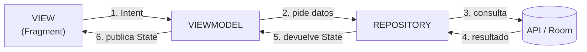
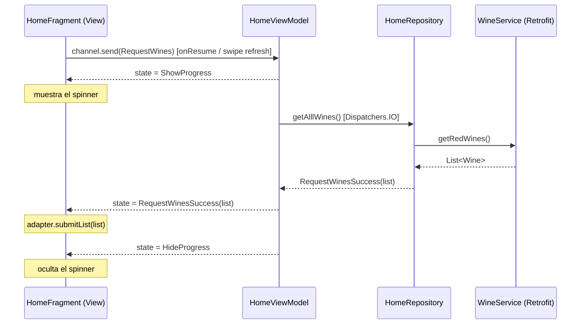

# 🍷 Wines Base

App Android (Kotlin) que muestra un listado de vinos tintos, permite guardarlos como favoritos y editarlos. El objetivo real del proyecto es **aprender y entender la arquitectura MVI** (Model - View - Intent) aplicada a una app Android con ViewModel, Coroutines y StateFlow.

---

## 📋 Tabla de contenido

1. [Qué hace la app](#-qué-hace-la-app)
2. [Tecnologías](#-tecnologías)
3. [Cómo correr el proyecto](#-cómo-correr-el-proyecto)
4. [Estructura del proyecto](#-estructura-del-proyecto)
5. [Arquitectura MVI paso a paso](#-arquitectura-mvi-paso-a-paso)
6. [Flujo completo: ejemplo real con `Home`](#-flujo-completo-ejemplo-real-con-home)
7. [Cómo agregar un módulo nuevo con MVI](#-cómo-agregar-un-módulo-nuevo-con-mvi)
8. [Notas sobre datos simulados](#-notas-sobre-datos-simulados)

---

## 🎯 Qué hace la app

| Pantalla | Qué hace |
|----------|----------|
| **Login** | Inicia sesión con un usuario simulado (no usa Firebase real). |
| **Home** | Descarga el listado de vinos tintos desde una API. Con *long click* sobre un vino lo agregas a favoritos. |
| **Favoritos** | Lista los vinos guardados en la base de datos local (Room). Permite quitarlos de favoritos y editarlos (*long click*). |
| **Promociones** | Lista de promociones. |
| **Cuenta** | Muestra los datos del usuario y permite cerrar sesión. |

---

## 🛠 Tecnologías

- **Lenguaje:** Kotlin
- **UI:** Fragments + ViewBinding + Navigation Component + BottomNavigation (Material)
- **Arquitectura:** MVI con `ViewModel`, `Channel` (intents) y `StateFlow` (estados)
- **Asincronía:** Kotlin Coroutines
- **Red:** Retrofit 2.9.0 + Gson
- **Base de datos local:** Room 2.6.1 (con KSP)
- **Imágenes:** Glide 4.16.0

Configuración del build: `compileSdk 34`, `minSdk 24`, `targetSdk 34`, Gradle 8.2, Android Gradle Plugin 8.2.1, Kotlin 1.9.10.

---

## 🚀 Cómo correr el proyecto

### Requisitos

- **Android Studio Hedgehog (2023.1.1)** o superior.
- **JDK 17** (viene incluido con Android Studio, es el que usa AGP 8.x).
- **Android SDK 34** instalado (Android Studio lo ofrece al abrir el proyecto).
- Un **emulador** (API 24 o superior) o un **dispositivo físico** con depuración USB activada.
- **Conexión a internet** (la lista de vinos se descarga de una API pública).

### Pasos

1. **Clona el repositorio**

   ```bash
   git clone https://github.com/chekelon/Wines_Base.git
   cd Wines_Base
   ```

2. **Abre el proyecto en Android Studio**
   `File > Open...` y selecciona la carpeta `Wines_Base`.

3. **Espera la sincronización de Gradle**
   Android Studio descargará Gradle 8.2 y las dependencias automáticamente. Si no inicia solo: `File > Sync Project with Gradle Files`.

4. **Elige un dispositivo**
   En la barra superior selecciona un emulador (`Device Manager > Create Device`) o conecta tu teléfono.

5. **Ejecuta la app**
   Presiona ▶️ **Run 'app'** (o `Shift + F10`).

### Desde la terminal (opcional)

```bash
# Compilar el APK de debug
./gradlew assembleDebug

# Instalarlo en el dispositivo/emulador conectado
./gradlew installDebug
```

En Windows usa `gradlew.bat` en lugar de `./gradlew`.

### Credenciales de prueba

El login es simulado (`FakeFirebaseAuth`). Usa:

| Campo | Valor |
|-------|-------|
| Usuario | `cursosant` |
| PIN | `1234` |

> Al abrir la app por primera vez, la verificación de sesión es aleatoria: puede entrar directo o mostrarte el formulario de login. Es intencional (ver [Notas sobre datos simulados](#-notas-sobre-datos-simulados)).

---

## 🗂 Estructura del proyecto

El código está organizado **por módulos de funcionalidad** (feature), y cada módulo repite la misma estructura MVI:

```
app/src/main/java/com/cursosant/winesbase/
│
├── WineApplication.kt              ← Crea la base de datos Room al iniciar la app
│
├── mainModule/
│   └── view/MainActivity.kt        ← Activity única: lanza el Login y configura la navegación
│
├── loginModule/                    ┐
├── homeModule/                     │
├── favoriteModule/                 │  Cada módulo sigue la misma estructura:
├── promoModule/                    │
├── accountModule/                  │
├── updateModule/                   ┘
│   ├── intent/XxxIntent.kt         ← INTENT: acciones que el usuario/vista quiere hacer
│   ├── model/XxxState.kt           ← STATE:  todos los estados posibles de la pantalla
│   ├── model/XxxRepository.kt      ← Lógica de datos: decide de dónde salen y devuelve un State
│   ├── model/RoomDatabase.kt       ← Acceso a datos locales del módulo
│   ├── XxxViewModel.kt             ← Recibe intents, ejecuta el trabajo y publica states
│   ├── XxxViewModelFactory.kt      ← Construye el ViewModel con su repositorio
│   └── view/XxxFragment.kt         ← VIEW: envía intents y pinta states
│
└── commonModule/
    ├── entities/                   ← Wine, Promo, Rating, FirebaseUser
    ├── dataAccess/
    │   ├── retrofit/WineService.kt ← Llamadas a la API
    │   ├── room/                   ← WineDatabase, WineDao, WineConverters
    │   └── local/                  ← FakeDatabase, FakeFirebaseAuth (datos simulados)
    ├── utils/Constants.kt          ← URL base, códigos de error (EC_*), argumentos
    └── view/WineBaseFragment.kt    ← Fragment base con ViewBinding (lo heredan Home y Favoritos)
```

---

## 🧠 Arquitectura MVI paso a paso

**MVI** = **M**odel · **V**iew · **I**ntent. Su idea central es un **flujo de datos unidireccional**: la información viaja siempre en un solo sentido, formando un ciclo.



### Los 3 conceptos

| Concepto | Qué es | En este proyecto |
|----------|--------|------------------|
| **Intent** | Una *intención* del usuario o de la vista: "quiero cargar los vinos", "quiero agregar este vino". **No** es un `Intent` de Android. | `sealed class XxxIntent` |
| **Model / State** | Una representación inmutable de **cómo se ve la pantalla en este momento**: cargando, éxito, error… | `sealed class XxxState` |
| **View** | Solo hace dos cosas: **enviar intents** y **dibujar states**. No contiene lógica de negocio. | `XxxFragment` |

### Paso 1 · Define los Intents (lo que se puede hacer)

Un `sealed class` con todas las acciones posibles de la pantalla. Archivo: `homeModule/intent/HomeIntent.kt`

```kotlin
sealed class HomeIntent {
    data object RequestWines: HomeIntent()                  // sin datos → object
    data class AddWine(val wine: Wine): HomeIntent()        // con datos → data class
}
```

> 💡 Si la acción necesita datos (un vino, un usuario, un PIN) es `data class`; si no, es `data object`.

### Paso 2 · Define los States (lo que se puede ver)

Un `sealed class` con **todos** los estados posibles de la pantalla. Archivo: `homeModule/model/HomeState.kt`

```kotlin
sealed class HomeState {
    data object Init: HomeState()                                   // estado inicial
    data object ShowProgress: HomeState()                           // mostrar cargando
    data object HideProgress: HomeState()                           // ocultar cargando
    data class RequestWinesSuccess(val list: List<Wine>): HomeState()
    data class AddWineSuccess(val msgRes: Int): HomeState()
    data class Fail(val code: Int, val msgRes: Int): HomeState()    // error con código y mensaje
}
```

> 💡 Al ser `sealed class`, el `when` de la vista **obliga** a manejar todos los casos: el compilador te avisa si olvidas alguno.

### Paso 3 · El Repository decide y devuelve un State

El repositorio consulta la fuente de datos y **traduce el resultado a un State** (éxito o error). Archivo: `homeModule/model/HomeRepository.kt`

```kotlin
class HomeRepository(private val db: RoomDatabase, private val service: WineService) {

    suspend fun getAlllWines(): HomeState {
        try {
            val wines = service.getRedWines()
            return if (wines.isNotEmpty()) HomeState.RequestWinesSuccess(wines)
            else HomeState.Fail(Constants.EC_REQUEST_NO_WINES, R.string.home_no_wines)
        } catch (e: Exception) {
            return HomeState.Fail(Constants.EC_REQUEST, R.string.common_general_fail)
        }
    }

    fun addWine(wine: Wine): HomeState {
        val result = db.addWine(wine)
        return if (result == -1L) HomeState.Fail(Constants.EC_SAVE_WINE, R.string.room_save_fail)
        else HomeState.AddWineSuccess(R.string.room_save_success)
    }
}
```

> ⚠️ En el código real `getAlllWines()` incluye además un `Random.nextBoolean()` que simula fallos del servidor (ver [Notas](#-notas-sobre-datos-simulados)).

### Paso 4 · El ViewModel conecta todo

Tiene **tres piezas clave**. Archivo: `homeModule/HomeViewModel.kt`

```kotlin
class HomeViewModel(private val repository: HomeRepository): ViewModel() {

    // (A) STATE: lo que la vista observa. Solo lectura desde afuera.
    private val _state = MutableStateFlow<HomeState>(HomeState.Init)
    val state: StateFlow<HomeState> = _state

    // (B) CHANNEL: la "bandeja de entrada" donde la vista deja sus intents.
    val channel = Channel<HomeIntent>(Channel.UNLIMITED)

    init { setupIntent() }

    // (C) Escucha el channel y decide qué hacer con cada intent.
    private fun setupIntent() {
        viewModelScope.launch {
            channel.consumeAsFlow().collect { intent ->
                when (intent) {
                    is HomeIntent.RequestWines -> getAllWines()
                    is HomeIntent.AddWine      -> addWine(intent.wine)
                }
            }
        }
    }

    private suspend fun getAllWines() {
        _state.value = HomeState.ShowProgress                 // 1. muestra "cargando"
        try {
            withContext(Dispatchers.IO) {
                _state.value = repository.getAlllWines()      // 2. trabaja en hilo IO y publica resultado
            }
        } finally {
            _state.value = HomeState.HideProgress             // 3. siempre oculta "cargando"
        }
    }
}
```

| Pieza | Qué es | Por qué |
|-------|--------|---------|
| `MutableStateFlow` / `StateFlow` | Guarda el **estado actual** y avisa a la vista cuando cambia | La vista recibe el último estado aunque se suscriba tarde |
| `Channel<Intent>` | Cola donde la vista **envía** intents | Desacopla a la vista: solo "deja el mensaje", no llama métodos del ViewModel |
| `consumeAsFlow().collect` | Procesa los intents uno por uno | Garantiza orden y un único punto de entrada |

### Paso 5 · La Factory crea el ViewModel

Como el `ViewModel` recibe un repositorio por constructor, necesita una `ViewModelProvider.Factory`. Archivo: `homeModule/HomeViewModelFactory.kt`

```kotlin
class HomeViewModelFactory(val repository: HomeRepository): ViewModelProvider.Factory {
    override fun <T : ViewModel> create(modelClass: Class<T>): T {
        if (modelClass.isAssignableFrom(HomeViewModel::class.java)) {
            @Suppress("UNCHECKED_CAST")
            return HomeViewModel(repository) as T
        }
        throw IllegalArgumentException("Clase de ViewModel desconocida")
    }
}
```

### Paso 6 · La View envía Intents y observa States

El `Fragment` tiene **solo dos responsabilidades**. Archivo: `homeModule/view/HomeFragment.kt`

**① Enviar intents** (cuando el usuario hace algo):

```kotlin
private fun getWines() {
    lifecycleScope.launch(Dispatchers.IO) {
        vm.channel.send(HomeIntent.RequestWines)     // "quiero la lista de vinos"
    }
}
```

**② Observar states** (y pintar la pantalla):

```kotlin
private fun setupObservers() {
    lifecycleScope.launch {
        vm.state.collect { state ->
            when (state) {
                is HomeState.Init                 -> {}
                is HomeState.ShowProgress         -> showProgress(true)
                is HomeState.HideProgress         -> showProgress(false)
                is HomeState.RequestWinesSuccess  -> adapter.submitList(state.list)
                is HomeState.AddWineSuccess       -> showMsg(state.msgRes)
                is HomeState.Fail                 -> handleError(state.code, state.msgRes)
            }
        }
    }
}
```

La vista **nunca** decide qué datos mostrar ni llama a la API: solo reacciona al `State` que le llega.

---

## 🔄 Flujo completo: ejemplo real con `Home`

Qué pasa cuando abres la pestaña **Home**:



Y cuando haces **long click → "Agregar a favoritos"**:

1. `HomeFragment.addToFavourites(wine)` marca `wine.isFavorite = true` y envía `HomeIntent.AddWine(wine)`.
2. `HomeViewModel` recibe el intent → publica `ShowProgress`.
3. Llama a `HomeRepository.addWine(wine)` → que inserta en Room (`WineDao.addWine`).
4. El repositorio devuelve `AddWineSuccess(msg)` (o `Fail(EC_SAVE_WINE, …)` si falló).
5. El ViewModel publica ese estado → el Fragment muestra un `Snackbar`.
6. El ViewModel publica `HideProgress`.

### Mapa de intents y estados por módulo

| Módulo | Intents | States principales |
|--------|---------|--------------------|
| **Login** | `CheckAuth`, `Login(username, pin)` | `AuthValid`, `LoginSuccess`, `Fail` |
| **Home** | `RequestWines`, `AddWine(wine)` | `RequestWinesSuccess`, `AddWineSuccess`, `Fail` |
| **Favoritos** | `RequestWines`, `AddWine(wine)`, `DeleteWine(wine)` | `RequestWinesSuccess`, `AddWineSuccess`, `DeleteWineSuccess`, `Fail` |
| **Promo** | `RequestPromos` | `RequestPromoSuccess`, `Fail` |
| **Account** | `RequestUser`, `SignOut` | `RequestUserSuccess`, `SignOutSuccess`, `Fail` |
| **Update** | `RequestWine(id)`, `UpdateWine(wine)` | `RequestWineSuccess`, `UpdateWineSuccess`, `Fail` |

Todos comparten además `Init` y (casi todos) `ShowProgress` / `HideProgress`.

### Flujo de arranque de la app

1. `WineApplication.onCreate()` construye la base de datos Room (`WineDatabase`).
2. `MainActivity` agrega `LoginFragment` encima de la pantalla.
3. `LoginViewModel` arranca en `LoginState.Init` → el Fragment reacciona enviando `LoginIntent.CheckAuth`.
4. Si la sesión es válida (`AuthValid`) o el login es correcto (`LoginSuccess`) → se cierra el Login y se muestra la barra de navegación.
5. La navegación (`mobile_navigation.xml`) abre **Home** como pantalla inicial.

---

## ➕ Cómo agregar un módulo nuevo con MVI

Sigue esta receta (usa `homeModule` como plantilla):

1. Crea la carpeta `miModule/` con las subcarpetas `intent/`, `model/` y `view/`.
2. **`MiIntent`**: `sealed class` con las acciones del usuario.
3. **`MiState`**: `sealed class` con `Init`, `ShowProgress`, `HideProgress`, los éxitos y `Fail(code, msgRes)`.
4. **`MiRepository`**: funciones que consultan datos y **devuelven un `MiState`** (nunca lanzan la excepción hacia la vista).
5. **`MiViewModel`**: `MutableStateFlow` + `Channel<MiIntent>` + `setupIntent()` con un `when` que despacha cada intent.
6. **`MiViewModelFactory`**: para inyectar el repositorio.
7. **`MiFragment`**: crea el ViewModel con la Factory, envía intents con `vm.channel.send(...)` y observa `vm.state` con un `when` exhaustivo.
8. Registra el Fragment en `res/navigation/mobile_navigation.xml` si es una pantalla de la barra inferior.

**Regla de oro:** la View nunca modifica datos ni llama al Repository directamente. Solo `send(Intent)` y `collect(State)`.

---

## 🧪 Notas sobre datos simulados

El proyecto es didáctico, así que algunas partes están simuladas a propósito:

- **API de vinos:** `https://api.sampleapis.com/wines/reds` (ver `Constants.kt` y `WineService.kt`). Es una API pública de ejemplo.
- **Fallos aleatorios en Home:** `HomeRepository.getAlllWines()` usa `Random.nextBoolean()` para simular que el servidor a veces responde y a veces devuelve una lista vacía. Si ves el mensaje de "sin vinos", haz *swipe to refresh*: es el comportamiento esperado para practicar el estado `Fail`.
- **Autenticación:** `FakeFirebaseAuth` no usa Firebase real; incluye retrasos (`delay`) para simular red, y el chequeo inicial de sesión también es aleatorio.
- **Persistencia:** los favoritos sí se guardan de verdad en Room (`WineDatabase`, tabla `WineEntity`).

### Códigos de error (`Constants.kt`)

| Constante | Valor | Significado |
|-----------|-------|-------------|
| `EC_AUTH` | 200 | Sesión no válida |
| `EC_LOGIN` | 210 | Credenciales incorrectas |
| `EC_REQUEST` | 300 | Error general de red |
| `EC_REQUEST_NO_WINES` | 310 | La API no devolvió vinos |
| `EC_REQUEST_USER` | 320 | Error al obtener el usuario |
| `EC_SAVE_WINE` | 400 | Error al guardar el vino |
| `EC_GET_WINE` | 410 | Error al consultar un vino |
| `EC_UPDATE_WINE` | 420 | Error al actualizar el vino |

---

## 📚 Para seguir aprendiendo

- [Guía de arquitectura de Android](https://developer.android.com/topic/architecture)
- [StateFlow y SharedFlow](https://developer.android.com/kotlin/flow/stateflow-and-sharedflow)
- [Canales de Kotlin Coroutines](https://kotlinlang.org/docs/channels.html)
